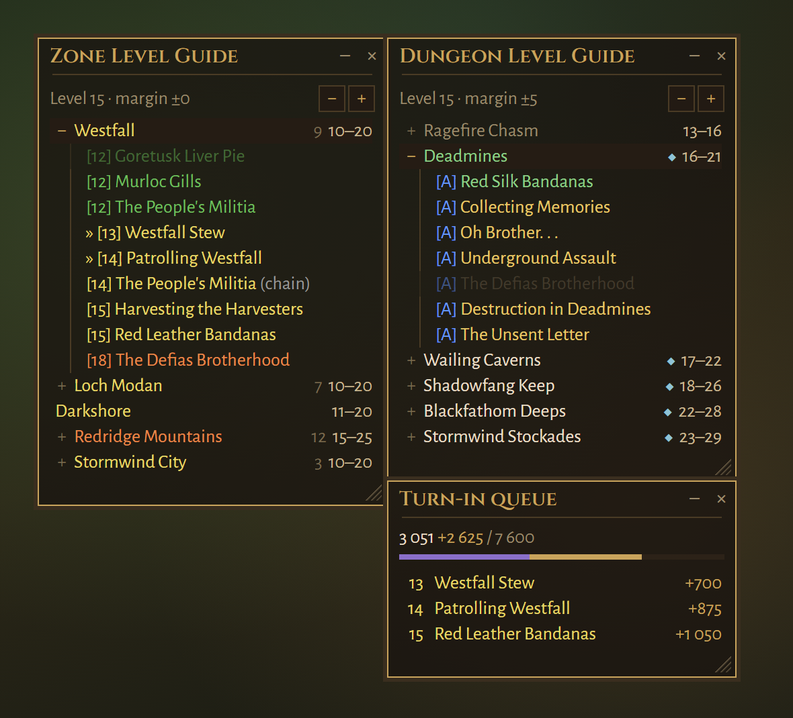
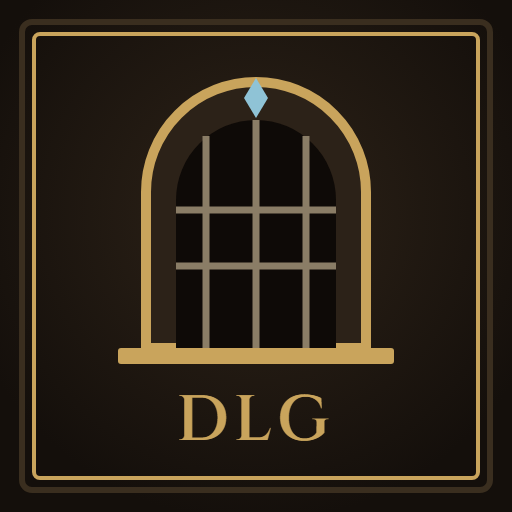
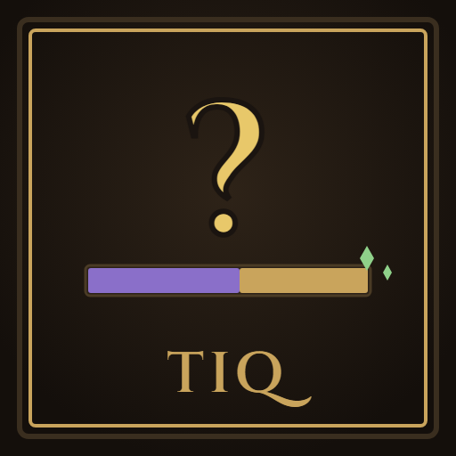
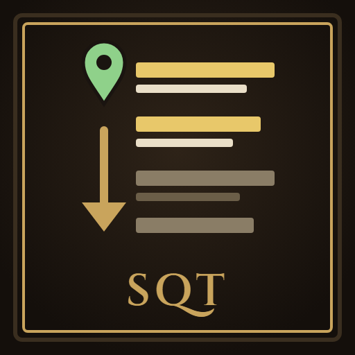
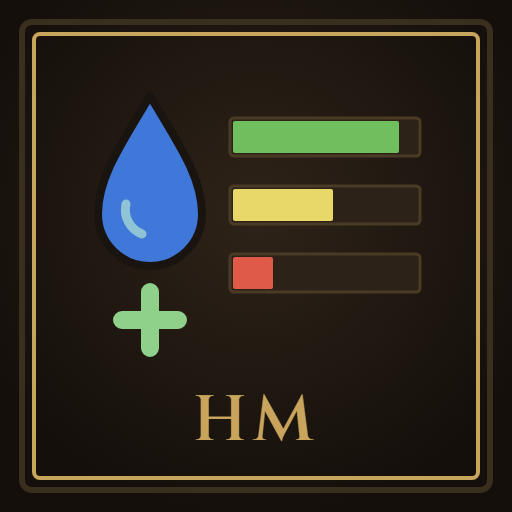

# WoW: Forever addons

Six small addons for **WoW: Forever**. The three panels, Zone Level Guide,
Dungeon Level Guide and Turn-In Queue, are built to work together: drop one
next to another and they snap and move as one.

| | Addon | What it does |
|---|---|---|
|  | [Zone Level Guide](ZoneLevelGuide/README.md) | The zones that suit your level, with every quest in them: where it starts, who gives it and at what level. |
|  | [Dungeon Level Guide](DungeonLevelGuide/README.md) | The dungeons that fit your level right now, with their quests and one-click map pins. |
|  | [Turn-In Queue](TurnInQueue/README.md) | A turn-in queue for completed quests that shows whether handing them all in is enough to level up. |
|  | [Hide Quest Tracker](HideQuestTracker/README.md) | Fades the quest tracker out in combat, and lets clicks pass through it until it is back. |
|  | [Sort Quest Tracker](SortQuestTracker/README.md) | Puts the quests where you are first in the tracker, by level or by distance. |
|  | [HealerMana](HealerMana/README.md) | The mana of the healers in your group or raid, one bar for each. |

## Installation

Download them from CurseForge, or copy the addon folders from this repository
into `World of Warcraft/_forever_/Interface/AddOns/`.

## Contributing

Bug reports and ideas are welcome as issues. Zone Level Guide records the
quests you take and can help map Forever's quest chains: turn on **Help find
quest chains** in its settings, play, and email your
`WTF/Account/<account>/<realm>/<character>/SavedVariables/ZoneLevelGuide.lua`
to **wowtziera@gmail.com**. Your quests and answers go into the next release.

## Licence

GPL-3.0-or-later; see each addon's `LICENSE.txt` and its README for the
credits of included data and fonts.
